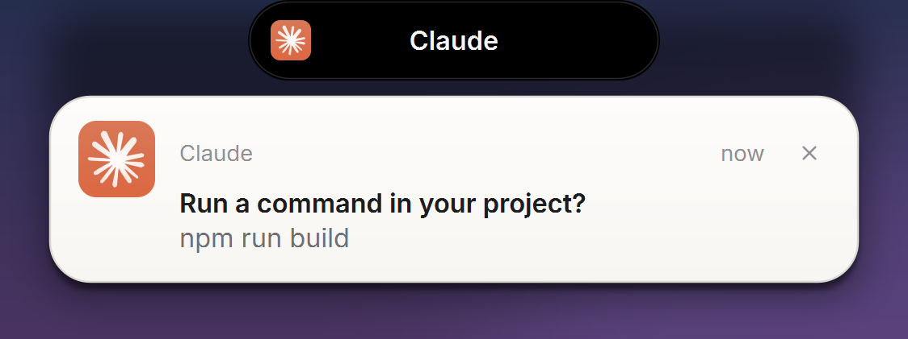
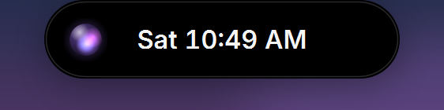
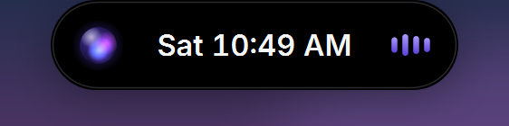
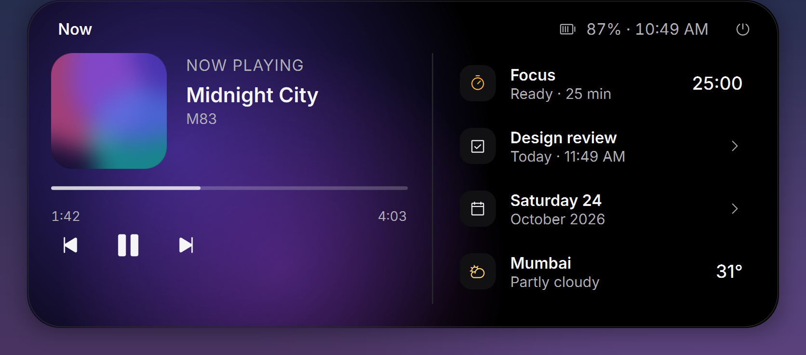
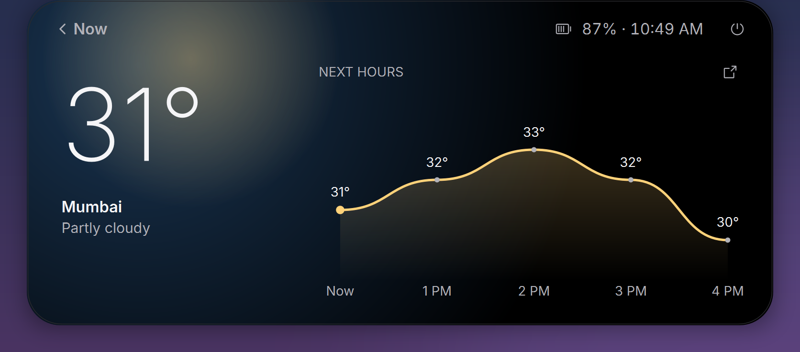
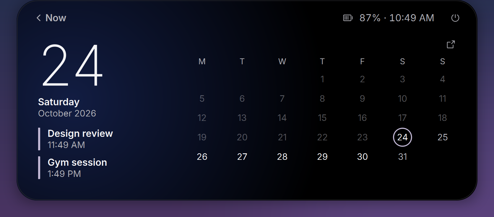
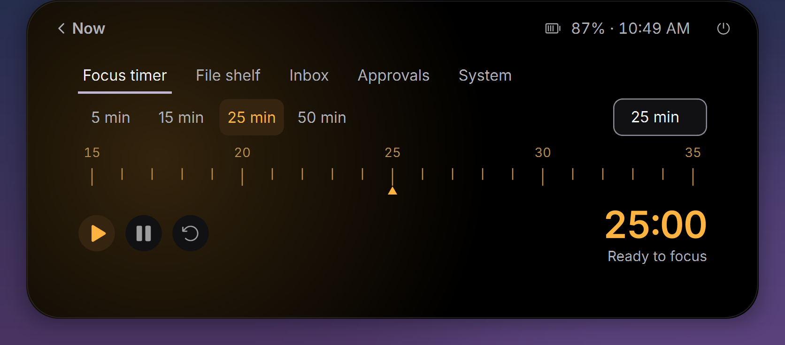
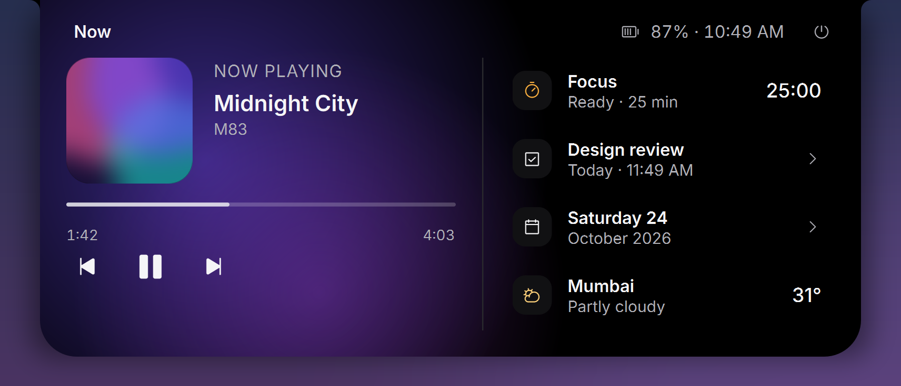

<p align="center">
  
</p>

<h1 align="center">Daisy</h1>

<p align="center">
  A calm, fast Dynamic Island for Windows.<br>
  Music, notifications, focus timer, weather and calendar, in a pill at the top of your screen.
</p>

<p align="center">
  <a href="https://github.com/harsh4k/daisy/releases/latest"><b>Download</b></a> ·
  <a href="#install">Install</a> ·
  <a href="#features">Features</a> ·
  <a href="#build-from-source">Build from source</a>
</p>

---

## Install

Open **PowerShell** (no admin needed) and run:

```powershell
irm https://raw.githubusercontent.com/harsh4k/daisy/main/install.ps1 | iex
```

This downloads the latest release, checks its SHA-256, installs it to
`%LOCALAPPDATA%\Programs\Daisy`, adds a Start Menu shortcut and starts it.
Run the same command again to update; your settings are kept.

Prefer to look first? Download `Daisy-win-x64.zip` from the
[latest release](https://github.com/harsh4k/daisy/releases/latest), unzip it and
run `install.ps1`, or just double-click `Daisy.exe` to try it without installing.

| Option | What it does |
|---|---|
| `-Startup` | Also start Daisy with Windows (off by default) |
| `-Version v1.0.0` | Install a specific release |
| `-InstallDir <path>` | Install somewhere else |
| `-NoLaunch` | Install without starting it |

To install with an option, save the script first:
`irm https://raw.githubusercontent.com/harsh4k/daisy/main/install.ps1 -OutFile install.ps1; .\install.ps1 -Startup`

**Uninstall:** `& "$env:LOCALAPPDATA\Programs\Daisy\uninstall.ps1"`
(add `-RemoveSettings` to delete your settings too).

**Needs** 64-bit Windows 10 (1809) or Windows 11.

## What you get

<p align="center">
  
  
</p>

The pill is a glance: an **aurora orb**, the time, and live **audio bars** when
something is playing. Both take the colour of the album art. Hover it to open it.

<p align="center">
  
</p>

**Now** puts what you are listening to first, with your next task, focus timer,
today's date and the weather beside it. Each one opens its own page. Scroll
inside the island to move between pages. Every page has its own light.

<p align="center">
  
  
</p>
<p align="center">
  
  
</p>

## Features

- **Notifications.** Windows notifications drop from the island as a light,
  porcelain card. Hover to keep it open. Caps Lock and Num Lock show in the pill.
- **Music.** Controls and a scrubber for Spotify, browsers and other players that
  use Windows media sessions. No account needed.
- **Focus timer** with presets, a custom length and a ruler. The countdown shows
  in the pill.
- **File shelf** to park files you are moving between windows.
- **Tasks, calendar and weather** for your city (searchable in settings).
- **AI permission requests** (optional, from source). See below.
- **Pill or Notch** shape, five themes, and a Reduce Motion mode that follows
  Windows.
- **Stays out of the way.** It hides behind games, fades to a thin line when idle
  and is click-through everywhere except the island itself.

Right-click the island for settings, themes, shape and startup.

<p align="center">
  
</p>

## Privacy

Daisy runs on your PC. It reads Windows media sessions and notifications that
Windows already shows you, and it does not send them anywhere. It makes two
kinds of web request, each only when you use that feature:

- weather and city search: [Open-Meteo](https://open-meteo.com)
- synced lyrics for the current track: [LRCLIB](https://lrclib.net)

Your settings live in `config.json` next to `Daisy.exe`.

## Build from source

You need Windows, Python 3.12 and PowerShell.

```powershell
git clone https://github.com/harsh4k/daisy.git
cd daisy
python -m venv .venv
.venv\Scripts\pip install -r requirements.txt
.venv\Scripts\python main.py                       # run it
.venv\Scripts\python -m unittest discover -s tests # run the tests
```

To build `Daisy.exe`:

```powershell
.venv\Scripts\pip install -r requirements-build.txt
powershell -File build_exe.ps1
```

The result is `dist\Daisy.exe`. `release\make_screenshots.py` regenerates the
images in this README.

### AI permission requests (advanced)

Daisy can show a Codex or Claude permission request with Allow and Deny. It
registers a hook in `~/.codex` and `~/.claude`, so it is opt-in and only for a
source checkout. See [`docs/ai-permission-support.md`](docs/ai-permission-support.md).

## Credits and licence

Daisy began as [Dynamic Island for Windows](https://github.com/rajsriv/dynamic-island-for-windows)
by Raj Srivastava and has since been redesigned. Code in this repository is
[MIT](LICENSE). Third-party licences, brand artwork and a note about PyQt6 are in
[NOTICE.md](NOTICE.md).

Daisy is not affiliated with or endorsed by Apple. "Dynamic Island" is Apple's
name for its own feature.
